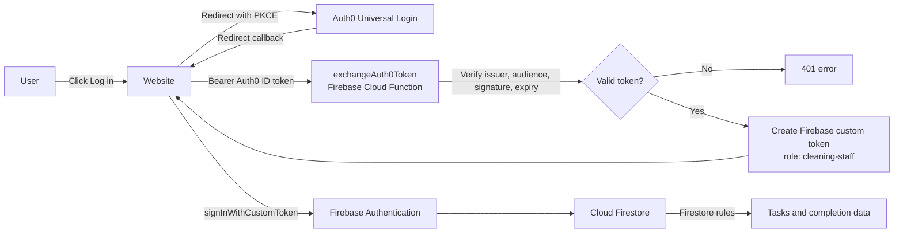

## Architecture  

The application uses Auth0 as the user-facing identity provider. Because the

frontend writes to Firestore, a Firebase Cloud Function exchanges the verified

Auth0 identity for a Firebase custom token. Firebase Authentication then gives

Firestore security rules an authenticated `request.auth` context.

  

This project currently uses Auth0's ID token for the exchange because no Auth0

API/audience was created. A dedicated Auth0 API with an access token is the

preferred long-term design.

  



  

The same diagram is available in [docs/auth0-workflow.mmd](docs/auth0-workflow.mmd).

  

## Authentication files

  

- [index.html](index.html) loads the Auth0 SPA SDK and Firebase Auth SDK and

displays the application login screen.

- [firebase-config.js](firebase-config.js) contains the public Firebase

configuration and Auth0 tenant/client configuration.

- [app.js](app.js) handles the Auth0 redirect, callback, token exchange,

Firebase sign-in, role assignment, and logout.

- [functions/index.js](functions/index.js) verifies the Auth0 JWT and creates a

Firebase custom token.

- [firestore.rules](firestore.rules) prevents unauthenticated Firestore

access and limits task administration to supervisors.

  

## Auth0 configuration

  

In Auth0, configure the application as a **Single Page Application**.

  

Use the tenant domain and client ID from the Auth0 application settings. The

client ID is public and may be present in frontend code; never expose an

Auth0 client secret.

  

Configure these URLs in **Applications → your application → Settings**:

  

```text

Allowed Callback URLs:

http://127.0.0.1:5500

https://dfyne-facilities.vercel.app

  

Allowed Logout URLs:

http://127.0.0.1:5500

https://dfyne-facilities.vercel.app

  

Allowed Web Origins:

http://127.0.0.1:5500

https://dfyne-facilities.vercel.app

```

  

## Firebase setup

  

The Firebase project is `dfynecleaners`. The repository includes:

  

- [firebase.json](firebase.json), which points Firebase CLI to Functions and

Firestore rules.

- [.firebaserc](.firebaserc), which selects the Firebase project.

- [functions/package.json](functions/package.json), which declares the

Functions dependencies and Node.js 22 runtime.

  

Install the Firebase CLI or run it through `npx`:

  

```bash

npx firebase-tools login

npx firebase-tools use dfynecleaners

```

  

Install Cloud Function dependencies from the Functions directory:

  

```bash

cd functions

npm install

cd ..

```

  

Deploy the token-exchange function:

  

```bash

npx firebase-tools deploy --only functions:exchangeAuth0Token

```

  

Deploy Firestore rules:

  

```bash

npx firebase-tools deploy --only firestore

```

  

The frontend expects the function at:

  

```text

https://us-central1-dfynecleaners.cloudfunctions.net/exchangeAuth0Token

```

  

## Required IAM permissions

  

Cloud Functions 2nd Gen builds and Firebase custom-token signing use several

Google-managed service accounts. If a deployment reports a missing permission,

grant the smallest role named in the error rather than Owner or Editor.

  

The accounts used by this project include:

  

```text

791645999553@cloudbuild.gserviceaccount.com

791645999553-compute@developer.gserviceaccount.com

service-791645999553@gcf-admin-robot.iam.gserviceaccount.com

```

  

The Compute service account needs these roles for the current deployment:

  

- Logs Writer

- Storage Object Viewer

- Artifact Registry Reader

- Artifact Registry Writer

- Service Account Token Creator

  

The Cloud Build service account needs Cloud Build Service Account. The Cloud

Functions service agent should retain Cloud Functions Service Agent.

  

## Firestore security

  

The original rules allowed anyone to read and write:

  

```text

allow read, write: if true;

```

  

That is unsafe. The rules in [firestore.rules](firestore.rules) require a

Firebase-authenticated session:

  

- Authenticated users can read tasks.

- Cleaners can read and write completion records.

- Only users with `role == "supervisor"` can create, update, or delete tasks.

- Users cannot write their own role records.

  

The current Cloud Function assigns authenticated users the role

`cleaning-staff`. Supervisor access is intentionally not enabled until a

trusted supervisor authorization process is configured.

  

## Local development

  

Start the static website with VS Code Live Server and open:

  

```text

http://127.0.0.1:5500

```

  

The expected flow is:

  

1. The website displays its login screen.

2. The user clicks **Log in**.

3. Auth0 Universal Login handles credentials.

4. Auth0 redirects back to the website.

5. The website sends the Auth0 token to the Cloud Function.

6. The Cloud Function verifies the token and creates a Firebase token.

7. The website signs into Firebase and opens the task board.

  

The Auth0 redirect is not a second user login. Firebase sign-in happens

automatically in the background so Firestore rules can recognize the user.

  

## Troubleshooting

  

### Auth0 says `Unknown client`

  

The Auth0 domain and client ID do not belong to the same Auth0 tenant. Copy

both values from the same Auth0 application.

  

### CORS preflight returns `403`

  

The deployed function must be publicly invokable so the browser can perform

the preflight request. The function still verifies the Auth0 token before

returning a Firebase token.

  

### Function returns `401`

  

Check the Cloud Function logs:

  

```bash

npx firebase-tools functions:log --only exchangeAuth0Token

```

  

An Auth0 verification error means the issuer, audience, signature, or expiry

does not match. A `signBlob` error means the runtime service account needs the

Service Account Token Creator role.

  

### Deployment fails during build

  

Open the Cloud Build log and grant only the exact missing role to the service

account named in the error. Common permissions include Cloud Logging,

Cloud Storage source access, and Artifact Registry read/write access.

  

## Billing

  

Cloud Functions may require the Firebase Blaze plan. Billing is based on

usage, not source-code size. Budgets send alerts but are not hard spending

limits. Monitor the Firebase/Google Cloud billing page and disable billing if

you want to stop paid services.

  

## Deployment checklist

  

```bash

npx firebase-tools login

npx firebase-tools use dfynecleaners

cd functions && npm install && cd ..

npx firebase-tools deploy --only functions:exchangeAuth0Token

npx firebase-tools deploy --only firestore

```

  

After deploying the frontend to Vercel, test both:

  

```text

http://127.0.0.1:5500

https://dfyne-facilities.vercel.app

```